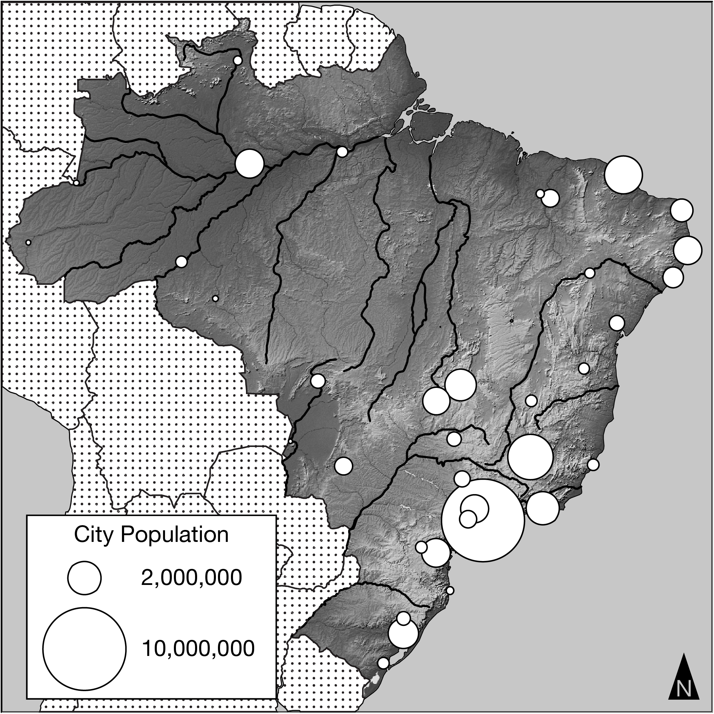

# 📘 AP Human Geography — Consequences of Population Distribution Quiz (CED Topic 2.2)
**Assessment**: Consequences of Population Distribution Quiz  
**Assignment ID**: `82042398` | **Assessment ID**: `22314991`  
**Course**: AP Human Geography (Period 6 — Ms. Anne Knight, Room 1325)  
**Student**: Antony Anish (`ID: 236151992` | AP UID: `9X4U27WU`)  
**Status**: Completed & Submitted | **Student Score**: **3 / 3 (100% Mastery)**  
**Time Taken**: 149.16 seconds (~2.5 minutes)  
**Scheduled Horizon**: Created Mon Oct 26, 2026 1:33 PM • Due Wed Oct 28, 2026 8:00 AM (Block Day Unit 2 MCQ Summative Prep)

---

## 🎯 Tested Curriculum Matrix
* **Unit 2**: Population and Migration Patterns and Processes (CED 2.1–2.12)
* **Topic 2.2**: Consequences of Population Distribution
* **Disciplinary Practice**: **Skill 2.C**: *Explain a likely outcome in a geographic scenario using geographic concepts, processes, models, or theories.*

---

## 📋 Full Stimulus Question Bank, Rationales & AP Trap Alerts

### Question 1: Effect of migration patterns in Brazil
* **College Board Reference**: `VH929906`
* **Topic**: `Topic 2.2: Consequences of Population Distribution`
* **Skill**: `Skill 2.C: Explain a likely outcome in a geographic scenario using geographic concepts, processes, models, or theories.`
* **Stimulus Graphic**: High-resolution proportional symbol map of Brazil city populations.
* **Local Asset Path**: `images/VH929906.g03.png`

**Question Stem:**
> Which of the following best explains a likely effect of Brazil’s population distribution?

**Answer Choices:**
* [ ] (A) More uniform economic growth throughout the entire country as urban areas expand westward
* [ ] (B) Increased cultural unity as more people live in close proximity to one another in eastern Brazil
* [x] **(C) Uneven economic development as eastern Brazil experiences more growth than the sparsely inhabited western regions** *(Correct — Selected by Antony)*
* [ ] (D) The expansion of available farmland as people move to the cities, allowing more rural land to be farmed
* [ ] (E) More efficient political administration and improved governance as the population becomes more clustered

> [!WARNING]
> **AP Trap Alert on Question 1 (Spatial Disparities vs. Uniform Growth Trap)**:
> * **The Trap**: Distractor (A) claims *"more uniform economic growth throughout the entire country as urban areas expand westward"*. Many students think moving a capital (like Brasília) or urbanization automatically balances an entire country.
> * **The Reality**: Brazil's population remains heavily clustered along the Atlantic coastal strip. This clustering generates persistent **core-periphery inequality** (the southeast represents Brazil’s economic core, while the western interior and Amazonian periphery experience chronic infrastructure and income gaps).
> * **Distractor (B) Trap**: Distractor (B) claims *"increased cultural unity"*. Urban clustering actually increases socioeconomic segregation (favelas directly adjacent to luxury high-rises).

**Detailed Geographic Breakdown & Distractor Rationales:**
* **Why (C) is Correct**: Brazil’s population is heavily clustered along the Atlantic coastal strip (historically driven by sugar plantations, colonial trade ports, and modern industrial hubs like São Paulo and Rio de Janeiro). This spatial clustering concentrates capital investments, infrastructure, and skilled services along the coast, leaving the western interior and Amazonian regions economically marginal and underdeveloped (core-periphery disparity).
* **Why Distractors are Incorrect**:
  * *(A) is incorrect*: Growth is emphatically *not* uniform; interior expansion remains slow despite the planned relocation of the capital to Brasília.
  * *(B) is incorrect*: Clustered coastal populations face sharp socioeconomic segregation (favelas vs. wealthy enclaves), not enhanced cultural unity.
  * *(D) is incorrect*: Rural-to-urban migration does not necessarily increase available farmland, and in Brazil, agricultural expansion (soybeans, cattle ranching) is pushing into the Amazon frontier rather than utilizing abandoned land.
  * *(E) is incorrect*: Rapid urban clustering often leads to administrative strain, governance challenges, and overwhelmed municipal services.

---

### Question 2: Physiological density and carrying capacity
* **College Board Reference**: `VH932892`
* **Topic**: `Topic 2.2: Consequences of Population Distribution`
* **Skill**: `Skill 2.C: Explain a likely outcome in a geographic scenario using geographic concepts, processes, models, or theories.`
* **Stimulus**: Conceptual scenario (No image)

**Question Stem:**
> Which of the following explains why a country with a high physiological density (e.g., Japan, Egypt, or the Netherlands) risks exceeding its carrying capacity?

**Answer Choices:**
* [ ] (A) The population is clustered in key areas, so rural populations will not have easy access to public services such as schools and hospitals.
* [x] **(B) The population places a large amount of pressure on the arable land to produce enough food without risking severe environmental degradation.** *(Correct — Selected by Antony)*
* [ ] (C) The population is evenly dispersed throughout the country, so it is difficult to maintain infrastructure such as roads and telecommunication networks for the entire country.
* [ ] (D) There is a large number of people per unit of total land area, so there is no available land for farmers to raise crops and other food products.
* [ ] (E) The amount of farmers per unit of land area in these countries is too low to be able to support their populations.

> [!WARNING]
> **AP Trap Alert on Question 2 (Density Confusion Trap: Arithmetic vs. Physiological vs. Agricultural)**:
> * **The Trap**: Distractors (D) and (E) prey on students who memorize the word "density" without checking the exact denominator:
>   * *Distractor (D)* defines Arithmetic Density ($\frac{\text{Total People}}{\text{Total Land}}$).
>   * *Distractor (E)* defines Agricultural Density ($\frac{\text{Farmers}}{\text{Arable Land}}$) and falsely claims developed nations like Japan or Netherlands have "too few farmers to support their populations" (ignoring heavy mechanization and global imports).
> * **The Reality**: **Physiological Density is specifically $\frac{\text{Total Population}}{\text{Arable Land}}$**. A high ratio means intense pressure on farmable soil. When arable land is pushed past ecological limits to feed a dense population, the country risks exceeding its carrying capacity through soil salinization, chemical contamination, and erosion.

**Detailed Geographic Breakdown & Distractor Rationales:**
* **Why (B) is Correct**: Physiological density is calculated as $\frac{\text{Total Population}}{\text{Arable Land}}$. When this ratio is high, a large population depends on a very limited area of farmable soil. Intensive farming to meet subsistence needs leads to soil exhaustion, salinization, chemical contamination, and aquifer depletion—placing the territory at acute risk of exceeding its ecological carrying capacity.
* **Why Distractors are Incorrect**:
  * *(A) is incorrect*: Service access relates to infrastructure distribution, not carrying capacity.
  * *(C) is incorrect*: High physiological density countries (e.g., Egypt where 95%+ of people live on the 3% arable Nile delta) are densely clustered, not evenly dispersed.
  * *(D) is incorrect*: Confuses *arithmetic density* ($\frac{\text{Total Population}}{\text{Total Land}}$) with *physiological density*.
  * *(E) is incorrect*: Confuses *agricultural density* ($\frac{\text{Farmers}}{\text{Arable Land}}$) with physiological density. Japan and the Netherlands have low agricultural densities due to high mechanization.

---

### Question 3: Urban Population in MDCs
* **College Board Reference**: `VH911513`
* **Topic**: `Topic 2.2: Consequences of Population Distribution`
* **Skill**: `Skill 2.C: Explain a likely outcome in a geographic scenario using geographic concepts, processes, models, or theories.`
* **Stimulus**: Conceptual scenario (No image)

**Question Stem:**
> The increasing percentage of urban dwellers in more-developed countries is best explained by

**Answer Choices:**
* [x] **(A) greater access to job opportunities, resources, and facilities** *(Correct — Selected by Antony)*
* [ ] (B) a critical need for workers in the primary economic sector
* [ ] (C) an abundance of arable land for agricultural use
* [ ] (D) a desire for more living space and a slower lifestyle
* [ ] (E) inadequate health care and few educational resources

> [!WARNING]
> **AP Trap Alert on Question 3 (Economic Sector & Counterurbanization Trap)**:
> * **The Trap**:
>   * *Distractor (B)* claims cities grow due to a *"need for workers in the primary economic sector"*. The primary sector (farming, mining) is rural, not urban, and is heavily mechanized in MDCs.
>   * *Distractor (D)* claims people move to cities for *"more living space and a slower lifestyle"*. That describes **counterurbanization / suburban exurban flight**, which is the exact opposite of urban agglomeration.
> * **The Reality**: Urban growth in MDCs is propelled by the expansion of **tertiary (service) and quaternary (information/finance) agglomerations**. Cities offer specialized, high-wage jobs, universities, and advanced healthcare networks that act as powerful economic pull factors.

**Detailed Geographic Breakdown & Distractor Rationales:**
* **Why (A) is Correct**: More-developed countries (MDCs) feature economies dominated by tertiary (services), quaternary (information technology/finance), and quinary activities. These industries agglomerate in cities, offering higher wages, specialized employment, top-tier medical networks, universities, and cultural infrastructure, which act as powerful economic pull factors.
* **Why Distractors are Incorrect**:
  * *(B) is incorrect*: The primary sector (farming, logging, mining) is located in rural zones and is heavily mechanized, requiring fewer workers.
  * *(C) is incorrect*: Urban growth consumes or paves over arable land (suburban sprawl), rather than seeking it out.
  * *(D) is incorrect*: A desire for more living space drives *counterurbanization* or suburban exurban migration, not the overall percentage of urban dwellers.
  * *(E) is incorrect*: Cities in MDCs are distinguished by abundant and advanced healthcare/educational systems, not inadequate ones.
