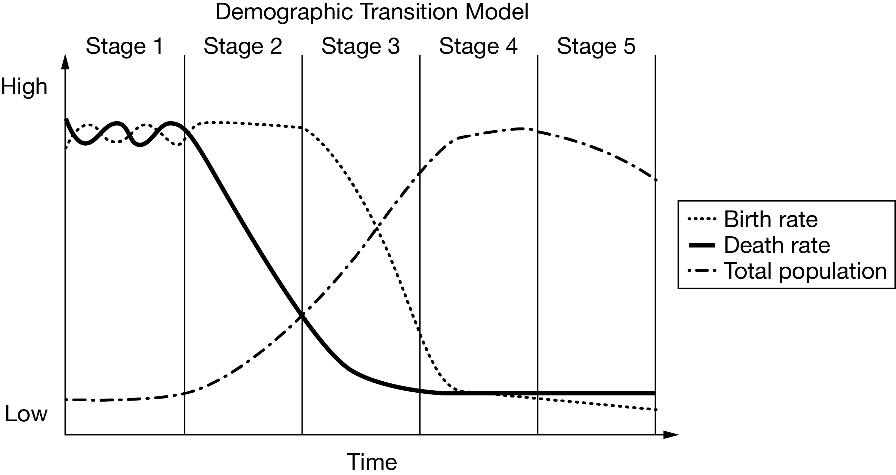

# 📘 AP Human Geography — The Demographic Transition Model Quiz (CED Topic 2.5)
**Assessment**: The Demographic Transition Model Quiz (MCQs)  
**Assignment ID**: `82042305` | **Assessment ID**: `22314965`  
**Course**: AP Human Geography (Period 6 — Ms. Anne Knight, Room 1325)  
**Student**: Antony Anish (`ID: 236151992` | AP UID: `9X4U27WU`)  
**Status**: Completed & Submitted | **Student Score**: **1 / 3 (33%)**  
**Total Time Spent**: 195.42 seconds (~3.25 minutes)  
**Assigned**: Mon Oct 26, 2026 1:33 PM • Due Wed Oct 28, 2026 8:00 AM (Block Day Unit 2 MCQ Summative Prep)

---

## 🎯 Tested Curriculum Matrix
* **Unit 2**: Population and Migration Patterns and Processes (CED 2.1–2.12)
* **Topic 2.5**: The Demographic Transition Model (DTM Stages 1–5 & Epidemiological Transition)
* **Disciplinary Practices**:
  * **Skill 2.C**: *Explain a likely outcome in a geographic scenario using geographic concepts, processes, models, or theories.*
  * **Skill 3.C**: *Explain patterns and trends in quantitative and geospatial data to draw conclusions.*

---

## 📋 Full Stimulus Question Bank, Rationales & AP Trap Alerts

### Question 1: Challenge of demographic transition stage five
* **College Board Reference**: `VH932929`
* **Topic**: `Topic 2.5: The Demographic Transition Model`
* **Skill**: `Skill 3.C: Explain patterns and trends in quantitative data to draw conclusions.`
* **Score**: **1 / 1 (Correct ✓)**
* **Stimulus**: Data Table — Demographic Indicators for Selected Countries

| Country | Female Life Expectancy | Male Life Expectancy | Percent Over Age 65 |
| :--- | :---: | :---: | :---: |
| **Germany** | 83 | 78 | 21% |
| **Italy** | 85 | 81 | 22% |
| **Japan** | 87 | 81 | 28% |

*(Source: Population Reference Bureau)*

**Question Stem:**
> Based on the data shown, which of the following describes the most likely population context for the countries listed?

**Answer Choices:**
* [ ] (A) High youth dependency ratio and a lack of economic resources to provide for large families
* [ ] (B) Rapid population growth in cities as people migrate from rural to urban areas for industrial jobs
* [ ] (C) Shortage of arable land on which to raise crops and other food products to support the population
* [ ] (D) Unstable food supply due to a rapidly growing population
* [x] **(E) Stage five of the demographic transition model due to very low birth rates** *(✅ Selected by Antony — CORRECT)*

> [!WARNING]
> **AP Trap Alert on Question 1 (Youth vs. Elder Dependency Ratio Trap)**:
> * **The Trap**: Distractor (A) mentions a *"high youth dependency ratio and a lack of economic resources to provide for large families"*. Students who see the word "dependency ratio" often blindly pick it without noting whether it specifies *youth* or *elder*.
> * **The Reality**:
>   * Germany (21%), Italy (22%), and Japan (28%) have unprecedentedly large proportions of their populations over age 65, combined with very high life expectancies ($80\text{--}87\text{ years}$).
>   * These countries are in **Stage 5 of the DTM**, characterized by sub-replacement Total Fertility Rates ($\approx 1.2\text{--}1.4$), birth rates falling below death rates, negative natural increase (population decline), and a severe **elder dependency crisis** (straining pensions, social security, and geriatric healthcare).
>   * Youth dependency ratios are high in **Stage 2** developing countries (e.g., Mali, Niger, Uganda), not post-industrial Stage 5 nations.

**Detailed Distractor Analysis & Pedagogical Breakdown:**
* **Why (E) is Correct**: Japan, Germany, and Italy are classic textbook examples of Stage 5 societies. Decades of prolonged low fertility rates (well below the 2.1 replacement level) combined with world-leading healthcare systems have inverted their population pyramids, concentrating more than a fifth of their citizens in the $\ge 65$ cohort.
* **Why Other Distractors are False**:
  * *(A) is incorrect*: These countries have an extremely *low* youth dependency ratio and abundant national economic wealth.
  * *(B) is incorrect*: Rapid rural-to-urban industrial migration occurs in Stage 2/3 (e.g., 19th-century Europe or modern South Asia), whereas urbanization in Germany/Italy/Japan is already long complete ($>75\text{--}90\%$).
  * *(C) is incorrect*: Physiological density relates to agricultural land pressure, not national demographic aging.
  * *(D) is incorrect*: Stage 5 economies have stable, high-tech food security and global trade networks, not unstable food supplies.

---

### Question 2: Country in stage three of demographic transition
* **College Board Reference**: `VH926464`
* **Topic**: `Topic 2.5: The Demographic Transition Model`
* **Skill**: `Skill 3.C: Explain patterns and trends in quantitative data to draw conclusions.`
* **Score**: **0 / 1 (Incorrect ❌)**
* **Stimulus Graphic**: Demographic Transition Model 5-Stage Diagram (Birth Rate, Death Rate, Total Population)
* **Local Asset Path**: `images/VH926464.g01.png`

**Question Stem:**
> Which of the following countries is best described as being at Stage 3 of the demographic transition model?

**Answer Choices:**
* [x] **(A) China: birth rate = 13, death rate = 7** *(❌ Selected by Antony — INCORRECT)*
* [ ] (B) Democratic Republic of the Congo: birth rate = 44, death rate = 10
* [ ] **(C) Bolivia: birth rate = 24 , death rate = 7** *(✅ OFFICIAL CORRECT ANSWER)*
* [ ] (D) Ivory Coast: birth rate = 37, death rate = 13
* [ ] (E) Hungary: birth rate = 10, death rate = 13

> [!WARNING]
> **AP Trap Alert on Question 2 (The "Developing Country Economy vs. One-Child Policy Legacy" Trap)**:
> * **Why Antony Got Trapped on (A)**: Antony recognized China as a major developing/industrializing nation known for massive factory manufacturing, and concluded it must fit Stage 3 (the industrializing stage).
> * **The Fatal Distractor Flaw in (A)**:
>   * In the DTM, stage classification is determined strictly by **Crude Birth Rate (CBR) and Crude Death Rate (CDR) values**, NOT by economic sector or developing status.
>   * Because of China's aggressive, state-enforced **One-Child Policy (1979–2015)**, its birth rate was artificially driven down decades ahead of normal economic development. With a CBR of only **13** and CDR of **7**, China has the vital statistics of a **Stage 4** country (approaching Stage 5).
> * **The Geographic Reality**:
>   * **Stage 3 Criteria**: CBR is in moderate decline ($\approx 20\text{--}30$), while CDR remains low ($\approx 5\text{--}10$).
>   * **Bolivia (CBR 24, CDR 7)** fits Stage 3 perfectly: fertility has fallen significantly from Stage 2 levels, death rates are low, and natural increase is moderate ($\approx 1.7\%$).
> * **Other Options Mapped to DTM Stages**:
>   * *(B) DR Congo (CBR 44, CDR 10)*: **Stage 2** (Extremely high CBR, high NIR $\approx 3.4\%$).
>   * *(D) Ivory Coast (CBR 37, CDR 13)*: **Stage 2** (Very high CBR, rapid growth).
>   * *(E) Hungary (CBR 10, CDR 13)*: **Stage 5** (CDR exceeds CBR; negative NIR $-0.3\%$).
> * **Exam Day Rule**:
>   $$\text{CBR } 35\text{--}50, \text{ CDR } 10\text{--}15 \rightarrow \mathbf{\text{Stage 2}}$$
>   $$\mathbf{\text{CBR } 20\text{--}30, \text{ CDR } 5\text{--}10} \rightarrow \mathbf{\text{Stage 3 (e.g., Bolivia, Mexico, India)}}$$
>   $$\text{CBR } 10\text{--}15, \text{ CDR } 7\text{--}10 \rightarrow \mathbf{\text{Stage 4 (e.g., USA, China)}}$$
>   $$\text{CDR } > \text{ CBR (both } \le 12\text{)} \rightarrow \mathbf{\text{Stage 5 (e.g., Hungary, Japan, Italy)}}$$

---

### Question 3: Demographic transition model Stages 4 and 5
* **College Board Reference**: `VH926218`
* **Topic**: `Topic 2.5: The Demographic Transition Model & Epidemiological Transition`
* **Skill**: `Skill 2.C: Explain a likely outcome in a geographic scenario using geographic concepts, models, or theories.`
* **Score**: **0 / 1 (Incorrect ❌)**
* **Stimulus Graphic**: Demographic Transition Model 5-Stage Diagram (Birth Rate, Death Rate, Total Population)
* **Local Asset Path**: `images/VH926218.g01.png`

**Question Stem:**
> Which of the following describes the most likely cause of death for a citizen of a country in stages 4 and 5 of the demographic transition model?

**Answer Choices:**
* [ ] (A) Infectious diseases due to poor sanitation
* [ ] **(B) Degenerative diseases due to old age and lifestyle** *(✅ OFFICIAL CORRECT ANSWER)*
* [ ] (C) Starvation due to an unstable food supply
* [ ] (D) Infectious diseases due to a lack of vaccines and antibiotics
* [x] **(E) Reemergence of previously eradicated diseases** *(❌ Selected by Antony — INCORRECT)*

> [!WARNING]
> **AP Trap Alert on Question 3 (Theoretical Stage 5 Label vs. Dominant Cause of Death Trap)**:
> * **Why Antony Got Trapped on (E)**: In the Epidemiological Transition Model (Abdel Omran), **Stage 5 is formally titled the "Stage of Reemerging Infectious Diseases"** (due to antibiotic resistance, global travel, and mutated pathogens like SARS/COVID-19). Antony remembered this label and selected (E).
> * **The Fatal Distractor Flaw in (E)**:
>   * The question did not ask *"What is the theoretical title of Stage 5 in the Epidemiological Transition?"*
>   * It asked: **"Which of the following describes the MOST LIKELY cause of death for a citizen of a country in stages 4 and 5?"**
>   * Even with disease reemergence, infectious pathogens cause only a small fraction of deaths in modern MDCs. The vast majority ($>70\text{--}80\%$) of citizens die from **chronic, non-communicable degenerative diseases**!
> * **The Geographic Reality**:
>   * Stage 4 of the Epidemiological Transition is the **Stage of Delayed Degenerative Diseases** (Olshansky & Ault).
>   * Cardiovascular diseases (heart attacks, strokes), cancers, diabetes, and neurodegenerative conditions (Alzheimer's) are overwhelmingly the primary causes of death in Stages 4 and 5 due to extended life spans, sedentary lifestyles, and processed diets.
> * **Epidemiological Transition Summary**:
>   * **Stage 1 (Pestilence & Famine)**: Infectious epidemics (Black Plague, cholera), parasitic attacks, famine/starvation.
>   * **Stage 2 (Receding Pandemics)**: Rapid drop in infectious disease deaths due to sanitation, clean water, and early antibiotics.
>   * **Stage 3 (Degenerative & Human-Created Diseases)**: Shift toward heart disease, cancer, and stroke.
>   * **Stage 4 (Delayed Degenerative Diseases)**: Medical treatments prolong life; deaths still predominantly degenerative (cardiovascular, cancer) but pushed to older age cohorts ($\ge 75$).
>   * **Hypothetical Stage 5 (Reemergence of Infectious Diseases)**: Threat of drug resistance (MRSA, MDR-TB) and zoonotic pandemics, but still secondary in volume to degenerative diseases.
> * **Exam Day Rule**: If an AP question asks for the **dominant or most likely cause of death in MDCs (Stages 4 & 5)**, the answer is always **degenerative / chronic lifestyle diseases (cardiovascular disease, cancer)**.

---

## 🧭 Topic 2.5 Quick Review Summary

| Metric | Stage 1 | Stage 2 | Stage 3 | Stage 4 | Stage 5 |
| :--- | :--- | :--- | :--- | :--- | :--- |
| **CBR** | Very High ($>40$) | High ($35\text{--}45$) | Declining ($\mathbf{20\text{--}30}$) | Low ($10\text{--}15$) | Very Low ($<10$) |
| **CDR** | Very High ($>40$) | Plummeting ($10\text{--}15$) | Low ($5\text{--}10$) | Low ($7\text{--}10$) | Slightly Rising ($10\text{--}13$) |
| **NIR** | Very Low ($\approx 0$) | **Rapid Increase** ($\ge 2.5\%$) | Moderate ($1\text{--}2\%$) | Stable / ZPG ($\approx 0\%$) | **Negative** ($<0\%$) |
| **Leading Cause of Death** | Epidemics, Famine | Cholera, Infections | Heart Disease, Cancer | **Delayed Degenerative** | **Degenerative + Aging** |
| **Example Country** | Isolated Tribes | DR Congo, Niger, Mali | **Bolivia**, Mexico, India | **USA, China** | **Japan, Germany, Italy, Hungary** |

---
*Created for Antony Anish • Period 6 AP Human Geography • Block Day Unit 2 MCQ Summative Preparation*
