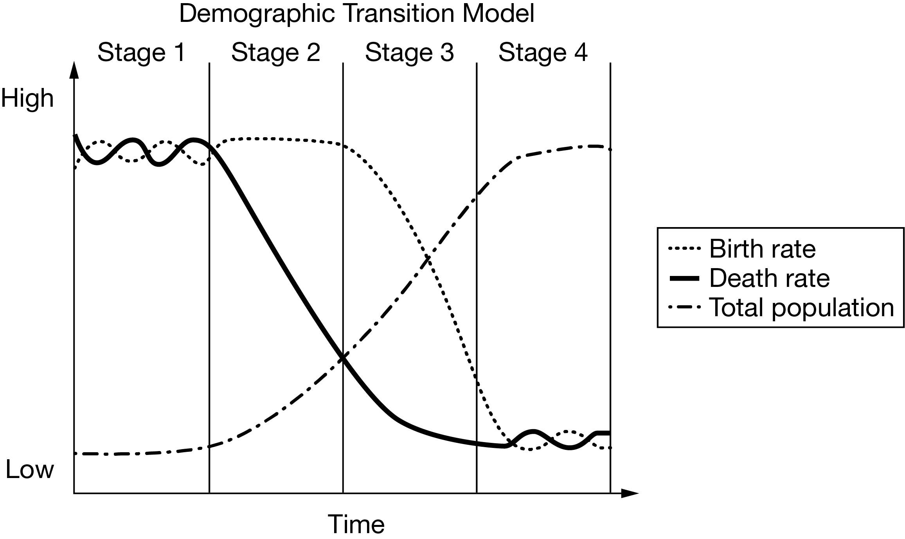
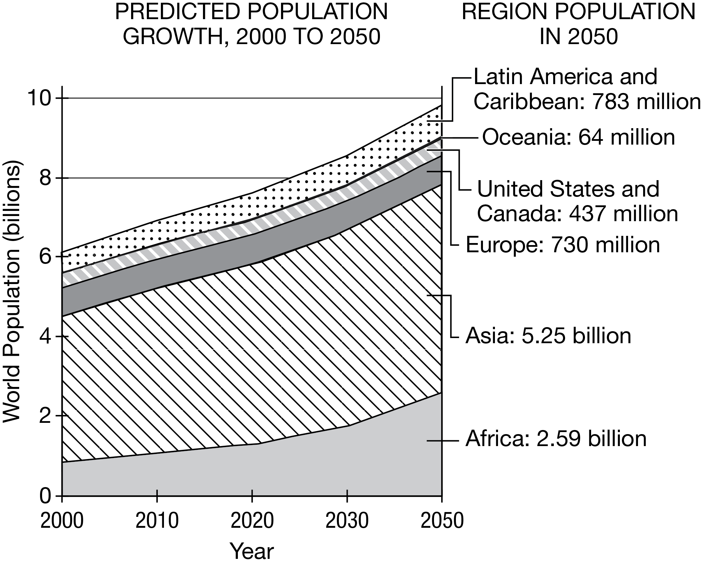

# 📘 AP Human Geography — Population Dynamics Quiz (CED Topic 2.4)
**Assessment**: Population Dynamics Quiz  
**Assignment ID**: `82042381` | **Assessment ID**: `22314987`  
**Course**: AP Human Geography (Period 6 — Ms. Anne Knight, Room 1325)  
**Student**: Antony Anish (`ID: 236151992` | AP UID: `9X4U27WU`)  
**Status**: Completed & Submitted | **Student Score**: **1 / 3 (33%)**  
**Total Time Spent**: 05:30 (Q1: 01:05, Q2: 03:01, Q3: 01:24)  
**Assigned**: Mon Oct 26, 2026 1:33 PM • Due Wed Oct 28, 2026 8:00 AM (Block Day Unit 2 MCQ Summative Prep)

---

## 🎯 Tested Curriculum Matrix
* **Unit 2**: Population and Migration Patterns and Processes (CED 2.1–2.12)
* **Topic 2.4**: Population Dynamics
* **Disciplinary Practice**: **Skill 3.C**: *Explain patterns and trends in maps and in quantitative and geospatial data to draw conclusions.*

---

## 📋 Full Stimulus Question Bank, Rationales & AP Trap Alerts

### Question 1: Development and demographic indicators
* **College Board Reference**: `VH911626`
* **Topic**: `Topic 2.4: Population Dynamics`
* **Skill**: `Skill 3.C: Explain patterns and trends in maps and in quantitative and geospatial data to draw conclusions.`
* **Time Spent**: 01:05 | **Score**: **0 / 1 (Incorrect)**
* **Stimulus Graphic**: Official 4-Stage Demographic Transition Model graph (Birth rate, Death rate, Total population curves).
* **Local Asset Path**: `images/VH911626.g01.png`

**Question Stem:**
> The low birth and death rates for a country in stage 4 of the demographic transition model are best explained by

**Answer Choices:**
* [ ] (A) the rural population and agricultural livelihood of a less developed country.
* [x] **(B) the level of education and traditional roles for women in a less developed country** *(❌ Selected by Antony — INCORRECT)*
* [ ] (C) the resource-based economy and life expectancy of a less developed country
* [ ] **(D) the level of urbanization and technological advancement of a more developed country** *(✅ OFFICIAL CORRECT ANSWER)*
* [ ] (E) the environmental pollution and manufacturing infrastructure of a more developed country

> [!WARNING]
> **AP Trap Alert on Question 1 (The "LDC Qualifier" Wording Trap)**:
> * **The Trap**: Antony selected **(B)** because his eyes immediately caught the trigger phrase *"level of education for women"*, which is standard AP phrasing for declining birth rates. However, the AP exam deliberately placed a **fatal disqualifier at the very end**: *"in a less developed country"*.
> * **The Reality**:
>   * Stage 4 countries are **More Developed Countries (MDCs)** by definition (e.g., US, UK, Canada, France, Japan).
>   * In Less Developed Countries (LDCs), traditional gender roles lead to **early marriage and high fertility rates** (Stage 2/3), the direct opposite of Stage 4.
>   * **Option (D)** is correct because in highly urbanized MDCs, children represent high financial costs (education, daycare, housing) rather than agricultural labor, while advanced medical systems maintain low crude death rates.

**Deep Distractor Analysis & Why Antony Got Trapped:**
* **Why Option (D) is Correct**: Stage 4 represents modern post-industrial societies. High urbanization makes raising children expensive (housing costs, childcare, higher education), which depresses birth rates. Advanced medical and sanitation technology keeps death rates low and life expectancy high.
* **Why Other Distractors are False**:
  * *(A) & (C)*: Rural agricultural populations and resource-based extractive economies are hallmarks of Stage 2 developing countries, not Stage 4.
  * *(E)*: Stage 4 economies have transitioned beyond heavy manufacturing and industrial pollution to clean tertiary and service-oriented sectors.

---

### Question 2: Megacity population growth
* **College Board Reference**: `VH911869`
* **Topic**: `Topic 2.4: Population Dynamics`
* **Skill**: `Skill 3.C: Explain patterns and trends in maps and in quantitative and geospatial data to draw conclusions.`
* **Time Spent**: 03:01 | **Score**: **1 / 1 (Correct ✓)**
* **Stimulus Table**: Metropolitan Area Population Data Table

| Metropolitan Area | 1950 | 1990 | 2015 | 2035 (Projected) |
| :--- | :---: | :---: | :---: | :---: |
| **City A** | 12.8 million | 16.1 million | 18.6 million | 20.8 million |
| **City B** | 2.3 million | 14.8 million | 20.9 million | 24.5 million |

**Question Stem:**
> Which of the following explains the pattern of growth in City B relative to City A ?

**Answer Choices:**
* [x] **(A) City B is located in a less developed country and has high rates of rural-to-urban migration, whereas City A is located in a more developed country and has low rates of rural-to-urban migration.** *(✅ Selected by Antony — CORRECT)*
* [ ] (B) City A is located in a less developed country and has high rates of rural-to-urban migration, whereas City B is located in a more developed country and has low rates of rural-to-urban migration.
* [ ] (C) City B is located in a less developed country and has a well-developed transportation system, whereas City A is located in a more developed country and has a limited transportation system.
* [ ] (D) City A is located in a less developed country and has a well-developed transportation system, whereas City B is located in a more developed country and has a limited transportation system.
* [ ] (E) City B is located in a more developed country and has a high number of urban amenities, whereas City A is located in a less developed country and has a limited number of urban amenities.

> [!WARNING]
> **AP Trap Alert on Question 2 (Urban Growth Rate vs. Urbanization Level Trap)**:
> * **The Trap**: Distractors (C), (D), and (E) attempt to trick students into assuming the faster-growing city must have better transportation or higher amenities because it is "growing so fast."
> * **The Reality**:
>   * **MDCs have a HIGH level of urbanization (~80%+), but a LOW rate of urban growth** (City A grew modestly from 12.8M to 18.6M because rural-to-urban migration finished decades ago).
>   * **LDCs have a LOWER level of urbanization (~40–50%), but an EXPLOSIVE rate of urban growth** (City B jumped 10-fold from 2.3M to 20.9M, driven by massive rural push factors and rapid natural increase).

**Deep Geographic Breakdown:**
* **Why Antony Aced This (A)**: City A was already a megacity in 1950 (12.8 million) and experienced modest growth (~62% over 65 years), typical of an MDC where urbanization is largely complete. In contrast, City B exploded from 2.3 million to 20.9 million (an ~800% increase), characteristic of developing nation megacities (e.g., Lagos, Dhaka, São Paulo) driven by rural push factors and perceived urban economic opportunities.

---

### Question 3: Population growth in the twenty-first century
* **College Board Reference**: `VH917081`
* **Topic**: `Topic 2.4: Population Dynamics`
* **Skill**: `Skill 3.C: Explain patterns and trends in maps and in quantitative and geospatial data to draw conclusions.`
* **Time Spent**: 01:24 | **Score**: **0 / 1 (Incorrect)**
* **Stimulus Graphic**: Stacked area graph of predicted regional population growth from 2000 to 2050.
* **Local Asset Path**: `images/VH917081.g03.png`

**Question Stem:**
> Based on the graph, predicted population growth in which of the following regions is explained by a high total fertility rate?

**Answer Choices:**
* [ ] (A) Asia
* [ ] **(B) Africa** *(✅ OFFICIAL CORRECT ANSWER)*
* [x] **(C) Latin America and Caribbean** *(❌ Selected by Antony — INCORRECT)*
* [ ] (D) Europe
* [ ] (E) United States and Canada

> [!WARNING]
> **AP Trap Alert on Question 3 (Total Population vs. Total Fertility Rate Trap)**:
> * **The Trap**: Antony selected **(C) Latin America and Caribbean**. Many students mistakenly group all developing regions together, assuming Latin America must have high fertility.
> * **The Reality**:
>   * Latin America underwent a dramatic fertility transition over the last 30 years; major nations (Brazil, Mexico, Colombia) have Total Fertility Rates near or below replacement level ($\approx 1.8\text{--}2.1$). On the graph, its population increases modestly from ~500M to 783M.
>   * **Sub-Saharan Africa is the ONLY world region maintaining high Total Fertility Rates (4.0 to 6.5+ children per woman)** (e.g., Niger $\approx 6.7$, Mali $\approx 5.8$). This high TFR causes Africa's population to more than triple from ~800 million to **2.59 billion**, driving over 60% of projected global population growth.

**Deep Distractor Analysis & Why Antony Got Trapped:**
* **Why Option (B) is Correct**: Total Fertility Rate (TFR) measures the average number of children born to a woman during her childbearing years. Sub-Saharan Africa remains in Stage 2/early Stage 3 of the DTM with the world's highest TFRs, resulting in the massive upward wedge on the graph.
* **Why Other Distractors are False**:
  * *(A) Asia*: Asia has the largest total population (5.25 billion by 2050), but its TFR has dropped substantially (China and East Asia have severe sub-replacement rates $< 1.2$, while India is at replacement $\approx 2.0$). Its growth is driven by demographic momentum, not a high TFR.
  * *(D) Europe*: Experiences population decline (730 million) due to sub-replacement TFRs.
  * *(E) US & Canada*: Modest growth driven primarily by international immigration, not high TFRs.
