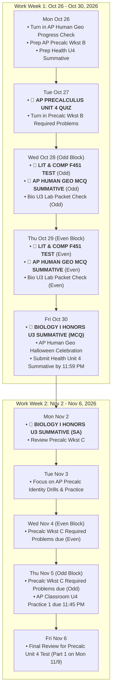

# Master Exam Schedule & Detailed Course Syllabus Guide
**Scope**: Forsyth County Schools – South Forsyth High School (Grade 9)  
**Student**: Antony Anish (`145283@forsythk12.org`) | **User ID**: `25181`  
**Time Horizon**: Next Two Work Weeks  
- **Week 1:** Monday, October 26, 2026 – Friday, October 30, 2026  
- **Week 2:** Monday, November 2, 2026 – Friday, November 6, 2026  
*(With forward lookout to Week 3: Monday, November 9 – Tuesday, November 10, 2026)*  
**Last Updated**: October 24, 2026  

---

## 1. Executive Master Summary & Assessment Matrix

| Course | Teacher | Assessment / Exam | Scheduled Date | Week | Weight / Type | Canvas Course Link |
| :--- | :--- | :--- | :--- | :--- | :--- | :--- |
| **AP Precalculus** | Mr. O'Connor / Ms. Shaw | **Unit 4 Quiz** (STE L1/L2 & SRE) | **Tuesday, Oct 27, 2026** | Week 1 | Formative / Quiz | [Course 276219](https://forsyth.instructure.com/courses/276219) |
| **Literature & Comp I Hnr** | Ms. Grote | **Fahrenheit 451 (F451) Test** | **Wed/Thu, Oct 28–29, 2026** | Week 1 | Summative / Test | [Course 276749](https://forsyth.instructure.com/courses/276749) |
| **AP Human Geography** | Ms. Knight | **Unit 2 MCQ Summative Exam** | **Wed/Thu, Oct 28–29, 2026** | Week 1 | Summative Exam | [Course 276433](https://forsyth.instructure.com/courses/276433) |
| **Biology I Honors** | Dr. Irwin | **Unit 3 Summative (Part 1: MCQ)** | **Friday, Oct 30, 2026** | Week 1 | Major Summative | [Course 276259](https://forsyth.instructure.com/courses/276259) |
| **Biology I Honors** | Dr. Irwin | **Unit 3 Summative (Part 2: SA)** | **Monday, Nov 2, 2026** | Week 2 | Major Summative | [Course 276259](https://forsyth.instructure.com/courses/276259) |
| **Health** | Coach Scott | **Unit 4 Nutrition Summative** | **Due by Saturday, Oct 31, 2026** | Week 1 | Summative / Test | [Course 274850](https://forsyth.instructure.com/courses/274850) |
| **Intro to Healthcare** | Ms. Upchurch | *No Major Exam Scheduled* | Regular Classwork | Weeks 1 & 2 | Delivery Systems & Vocab | [Course 276503](https://forsyth.instructure.com/courses/276503) |
| **Intro to Software Tech** | Mr. Smith | *No Exam Scheduled* | Regular Projects | Weeks 1 & 2 | JS Intro / Resume P2 (Due 11/20) | [Course 276679](https://forsyth.instructure.com/courses/276679) |

---

## 2. Chronological Day-by-Day Action Timeline

---

## 3. Deep-Dive Subject Breakdown & Syllabus Requirements

### A. AP Precalculus – O'Connor & Shaw
- **Canvas Course ID**: `276219`
- **Instructors**: Mr. James O'Connor (Room 465, `joconnor@forsyth.k12.ga.us`) & Ms. Christine Shaw (Room 1414, `cshaw@forsyth.k12.ga.us`)
- **Primary Assessment**: **Unit 4 Quiz (STE & SRE)** on **Tuesday, October 27, 2026**
- **Forward Horizon**: **Unit 4 Test Part 1** on **Monday, Nov 9** and **Part 2** on **Tuesday, Nov 10**

#### Scope & Tested Objectives
1. **Solving Trigonometric Equations (STE)**:
   - Factoring quadratic-form trigonometric expressions.
   - Solving trig equations by squaring both sides (checking for extraneous solutions).
   - Solving trig equations involving multiple angles (e.g. $\sin(2\theta)$, $\cos(3\theta)$).
   - Writing general solutions across all periods ($+ 2\pi k$ or $+ \pi k$).
2. **Simplify, Rewrite, and Evaluate (SRE)**:
   - Sum and Difference Identities: $\sin(\alpha \pm \beta)$, $\cos(\alpha \pm \beta)$, $\tan(\alpha \pm \beta)$.
   - Product-to-Sum and Sum-to-Product Identities.
   - Double-Angle and Half-Angle Identities.
   - Power-Reducing Identities.

#### Crucial Deadlines & Prerequisites
- **Tuesday, Oct 27 (Start of Class)**: [Unit 4 Worksheet B](file:///Volumes/Backup/Antony/HighSchool/Grade9/Math) Required Problems must be completed and turned in.
- **Wednesday/Thursday, Nov 4–5**: Unit 4 Worksheet C Required Problems due at start of class.
- **Thursday, Nov 5 (11:45 PM)**: AP Classroom Unit 4 Practice 1 assignment due.
- **Monday, Nov 9**: Unit 4 Worksheet A due at start of class for bonus points.

---

### B. Literature & Composition I Honors – Grote
- **Canvas Course ID**: `276749`
- **Instructor**: Ms. Jessica Grote (Room 1314, `f43679@forsyth.k12.ga.us`)
- **Primary Assessment**: **Fahrenheit 451 (F451) Test** on **Wednesday/Thursday, October 28–29, 2026** (Block Days)
- **Detailed Subject Guide**: [`LITERATURE_COMP_HONORS_F451_EXAM_GUIDE.md`](file:///Volumes/Backup/Antony/HighSchool/Grade9/000-Exam/LITERATURE_COMP_HONORS_F451_EXAM_GUIDE.md)
- **Full Practice Exam & Self-Test**: [`LITERATURE_F451_PRACTICE_TEST.md`](file:///Volumes/Backup/Antony/HighSchool/Grade9/000-Exam/LITERATURE_F451_PRACTICE_TEST.md)
- **Archived Book & Organizers in Folder**:
  - [`Fahrenheit 451.pdf`](file:///Volumes/Backup/Antony/HighSchool/Grade9/000-Exam/Fahrenheit%20451.pdf)
  - [`Fahrenheit 451 Source Analysis Sheets.pdf`](file:///Volumes/Backup/Antony/HighSchool/Grade9/000-Exam/Fahrenheit%20451%20Source%20Analysis%20Sheets.pdf)

#### Scope & Tested Objectives
1. **Core Text**: Ray Bradbury's *Fahrenheit 451* (Parts 1, 2, and 3).
2. **Thematic Concepts (Unit 2: The Cost of Control)**:
   - State-enforced conformity vs. individual intellectual liberty.
   - The pacification and anesthesia of society via screen entertainment and instant gratification.
   - The duality of fire: destructive vs. purifying and warming.
3. **Key Motifs & Symbols**:
   - The Mechanical Hound, The Sieve and the Sand, The Phoenix, The Salamander, Mirrors and Clarisse McClellan.
4. **Skills Assessed**:
   - Rhetorical, connotative, and figurative language analysis.
   - Textual synthesis, thesis generation, and short DBQ-style analytical paragraph structure.

---

### C. AP Human Geography – Knight
- **Canvas Course ID**: `276433`
- **Instructor**: Ms. Anne Knight (Room 1325, `f41416@forsyth.k12.ga.us`)
- **Primary Assessment**: **Unit 2 MCQ Summative Exam** on **Wednesday/Thursday, October 28–29, 2026**
- *(Vocabulary Summative scheduled on agenda for Monday, Oct 26 / Friday, Oct 23)*

#### Scope & Tested Objectives (Unit 2: Population & Migration Dynamics)
- **2.1 Population Distribution & Density**: Calculating and contrasting arithmetic, physiological, and agricultural densities.
- **2.2 Consequences of Population Distribution**: Impact on infrastructure, environmental resources, political representation.
- **2.3–2.4 Population Composition & Trends**: Interpreting population pyramids (cohorts, dependency ratios, sex ratios); historical and contemporary growth/decline.
- **2.5–2.6 Theories of Population**: Demographic Transition Model (Stages 1–5), Epidemiological Transition, Thomas Malthus vs. Neo-Malthusians.
- **2.7 Population Policies**: Pro-natalist vs. Anti-natalist policies (China's One-Child policy, Singapore Case Study, Nordic childcare support).
- **2.8–2.9 Women & Aging**: Demographic dividends, female education and fertility decline, aging populations in MEDCs.
- **2.10–2.12 Migration Dynamics**: Push vs. pull factors, Ravenstein's Laws of Migration, forced vs. voluntary migration, remittances (economic and social impact), refugees and internally displaced persons (IDPs).

#### Preparation & Resources
- Complete AP Classroom MCQ progress check questions.
- Categorilla practice terms and Hexagonal Thinking vocabulary connections.
- Turn in the Unit 2 Progress Check paper on **Monday, Oct 26**.

---

### D. Biology I Honors – Dr. Irwin
- **Canvas Course ID**: `276259`
- **Instructor**: Dr. Irwin (Room 371)
- **Primary Assessments**:
  - **Unit 3 Summative – Part 1 (MCQ)**: **Friday, October 30, 2026**
  - **Unit 3 Summative – Part 2 (Short Answer / SA)**: **Monday, November 2, 2026**
  - *(Unit 3 Lab Packet Check – Formative: Wednesday/Thursday, Oct 28–29)*
- **Local Master Study Portal & Worked Answer Keys**:
  - [`Unit_03_Summative_Study_Portal.html`](file:///Volumes/Backup/Antony/HighSchool/Grade9/000-Exam/Biology-Unit-3-Summative/Unit_03_Summative_Study_Portal.html) (Interactive Portal + 25-Q Summative Simulator)
  - [`Unit_03_Summative_Master_Study_Guide_and_Keys.md`](file:///Volumes/Backup/Antony/HighSchool/Grade9/000-Exam/Biology-Unit-3-Summative/Unit_03_Summative_Master_Study_Guide_and_Keys.md) (Full Review Stations 1–8 Key + 17-Page Lab Packet Key + SA Blueprints)

#### Scope & Tested Objectives (Unit 3: Cellular Energy & Metabolism)
1. **Enzymes & Biochemical Reactions**:
   - Enzyme structure, active site, substrate specificity, activation energy reduction.
   - Denaturation factors: pH, temperature, substrate concentration, competitive vs. non-competitive inhibition.
2. **Cellular Respiration**:
   - Chemical formula: $\text{C}_6\text{H}_{12}\text{O}_6 + 6\text{O}_2 \rightarrow 6\text{CO}_2 + 6\text{H}_2\text{O} + 36\text{--}38\text{ ATP}$.
   - Step 1: Glycolysis (cytoplasm; anaerobic; glucose to 2 pyruvate, net 2 ATP, 2 NADH).
   - Step 2: Pyruvate Oxidation & Krebs Cycle / Citric Acid Cycle (mitochondrial matrix; produces $\text{CO}_2$, ATP, NADH, $\text{FADH}_2$).
   - Step 3: Electron Transport Chain & Chemiosmosis (inner mitochondrial cristae; $\text{O}_2$ as final electron acceptor yielding $\text{H}_2\text{O}$, generating bulk ATP via ATP synthase).
3. **Photosynthesis**:
   - Chemical formula: $6\text{CO}_2 + 6\text{H}_2\text{O} + \text{light} \rightarrow \text{C}_6\text{H}_{12}\text{O}_6 + 6\text{O}_2$.
   - Light-Dependent Reactions (thylakoid membrane; photolysis of water at PSII, ETC 1 making ATP, PSI & ETC 2 making NADPH).
   - Light-Independent Reactions / Calvin Cycle (stroma; carbon fixation via RuBisCO, reduction to G3P/glucose, RuBP regeneration).
   - Algae Beads laboratory inquiry data and bicarbonate pH indicator analysis ($\text{pH } 7.6$ yellow in dark vs. $\text{pH } 9.2$ purple in light).

#### Archived Local PDFs in [`Biology-Unit-3-Summative/materials/`](file:///Volumes/Backup/Antony/HighSchool/Grade9/000-Exam/Biology-Unit-3-Summative/materials/)
- [`Cellular_Energy_Review_Stations_Student_Handout.pdf`](file:///Volumes/Backup/Antony/HighSchool/Grade9/000-Exam/Biology-Unit-3-Summative/materials/Cellular_Energy_Review_Stations_Student_Handout.pdf) & [`HB_Unit_3_Cellular_Energy_Review_Stations.pdf`](file:///Volumes/Backup/Antony/HighSchool/Grade9/000-Exam/Biology-Unit-3-Summative/materials/HB_Unit_3_Cellular_Energy_Review_Stations.pdf)
- [`Honors_Biology_Cellular_Respiration_Outline.pdf`](file:///Volumes/Backup/Antony/HighSchool/Grade9/000-Exam/Biology-Unit-3-Summative/materials/Honors_Biology_Cellular_Respiration_Outline.pdf) (*"Look at this Resource!"*)
- [`Honors_Biology_Photosynthesis_Script_Slides_1_13.pdf`](file:///Volumes/Backup/Antony/HighSchool/Grade9/000-Exam/Biology-Unit-3-Summative/materials/Honors_Biology_Photosynthesis_Script_Slides_1_13.pdf) (Supplementary Notes 3C.1) & [`Honors_Biology_Photosynthesis_Script_Slides_14_19.pdf`](file:///Volumes/Backup/Antony/HighSchool/Grade9/000-Exam/Biology-Unit-3-Summative/materials/Honors_Biology_Photosynthesis_Script_Slides_14_19.pdf) (Supplementary Notes 3C.2)
- [`HB_Unit_3A_Enzymes_PPT.pdf`](file:///Volumes/Backup/Antony/HighSchool/Grade9/000-Exam/Biology-Unit-3-Summative/materials/HB_Unit_3A_Enzymes_PPT.pdf), [`HB_Unit_3B_Cellular_Respiration_PPT.pdf`](file:///Volumes/Backup/Antony/HighSchool/Grade9/000-Exam/Biology-Unit-3-Summative/materials/HB_Unit_3B_Cellular_Respiration_PPT.pdf), & [`HB_Unit_3C_Photosynthesis_PPT.pdf`](file:///Volumes/Backup/Antony/HighSchool/Grade9/000-Exam/Biology-Unit-3-Summative/materials/HB_Unit_3C_Photosynthesis_PPT.pdf)
- [`Unit 3 Student Notes Packet 26-27.pdf`](file:///Volumes/Backup/Antony/HighSchool/Grade9/000-Exam/Biology-Unit-3-Summative/materials/Unit%203%20Student%20Notes%20Packet%2026-27.pdf) & [`Unit 3 Lab Packet 26-27.pdf`](file:///Volumes/Backup/Antony/HighSchool/Grade9/000-Exam/Biology-Unit-3-Summative/materials/Unit%203%20Lab%20Packet%2026-27.pdf)

---

### E. Health – Scott
- **Canvas Course ID**: `274850`
- **Instructor**: Coach Josef Scott (Room 563, `f47446@forsyth.k12.ga.us`)
- **Primary Assessment**: **Unit 4 Nutrition Summative** (Canvas ID: `934376`)
- **Deadline**: Active in Canvas with final submission due date **Saturday, October 31, 2026 (11:59 PM)**. *(Status: Pending submission)*

#### Scope & Tested Objectives (Unit 4: Nutrition & Dietary Literacy)
1. **Nutrient Classification**: Macronutrients (carbohydrates, proteins, fats) vs. Micronutrients (vitamins, minerals, water); energy densities ($4\text{ kcal/g}$ vs $9\text{ kcal/g}$).
2. **FDA Nutrition Facts Label Analysis**: % Daily Value, serving size calculations, added sugars, saturated/trans fat restrictions, sodium thresholds.
3. **MyPlate & Healthy Eating Patterns**: Balanced plate portions, nutrient density vs. empty calories.
4. **Community Health & Accessibility**: Food deserts, socioeconomic barriers to fresh produce, transit and urban nutritional infrastructure.
5. **Study Resource**: `Nutrition Study Guide.docx` posted on Canvas.

---

### F. Introduction to Healthcare – Upchurch
- **Canvas Course ID**: `276503`
- **Instructor**: Ms. Morgan Upchurch (Room 406, `f45629@forsyth.k12.ga.us`)
- **Status for Oct 26 – Nov 6**: **No exam or summative scheduled.**

#### Current Syllabus & Topics
- **Unit 4: Healthcare Delivery Systems**:
  - Distinguishing acute care, long-term care, outpatient facilities, specialty practices, government agencies (CDC, FDA, NIH, OSHA, WHO) and non-profit organizations (AHA, ACS, March of Dimes).
  - Health Insurance & Financial Terminology: Premiums, deductibles, copayments, coinsurance, HMO vs. PPO models, Medicare vs. Medicaid, TRICARE, Workers' Compensation.
- **Medical Terminology**: Ongoing root/prefix/suffix practice using Medical Terminology Set #3 and weekly crosswords.

---

### G. Introduction to Software Technology – Smith
- **Canvas Course ID**: `276679`
- **Instructor**: Mr. Graham Smith (Room 232, `f44886@forsyth.k12.ga.us`)
- **Status for Oct 26 – Nov 6**: **No exam or quiz scheduled.**

#### Current Syllabus & Topics
- **Unit 5: Introduction to JavaScript in Web Development**:
  - Script inclusion in HTML documents, syntax fundamentals, variables, event handling, and DOM element modification.
- **CTAE Career Pathway Work**:
  - Professional resume writing (Resume Action Verbs module).
  - Checkpoint 2 of "Crafting the Perfect Resume" is scheduled for **Friday, November 20, 2026**.

---

## 4. Recommended Weekly Study & Revision Plan

To balance high-stakes assessments across subjects without burnout:

1. **Sunday, Oct 25 – Monday, Oct 26**:
   - Focus: **AP Precalculus** (Worksheet B required problems) + **AP Human Geography** (Progress check submission and Unit 2 review).
   - Health: Complete and submit the **Unit 4 Nutrition Summative**.
2. **Tuesday, Oct 27**:
   - Execute: **AP Precalculus Unit 4 Quiz**.
   - Evening: Focus on **Literature & Composition** (review F451 key quotes, character arcs, and Bradbury's core themes) and **AP Human Geo** (models and DTM).
3. **Wednesday, Oct 28 – Thursday, Oct 29**:
   - Execute: **F451 Test** and **AP Human Geo MCQ Summative**.
   - Ensure Biology Lab Packet is complete for in-class stamp/check.
   - Evening: Deep-dive into **Biology Unit 3** (respiration formulas, light reactions, Calvin cycle, enzyme graphs).
4. **Friday, Oct 30**:
   - Execute: **Biology Unit 3 Summative (MCQ)**.
5. **Weekend (Oct 31 – Nov 1)**:
   - Prepare for **Biology Unit 3 Short Answer (SA)** questions: Practice drawing and explaining ATP generation, photosynthesis vs. cellular respiration gas exchange, and enzyme reaction curves.
6. **Monday, Nov 2**:
   - Execute: **Biology Unit 3 Summative (SA)**.
7. **Tuesday, Nov 3 – Friday, Nov 6**:
   - Pivot study focus to **AP Precalculus Unit 4 Test** (Worksheet C, Worksheet A bonus problems, AP Classroom Practice 1 due Thursday Nov 5).

---
*Documented and verified directly against active Canvas LMS course shells, syllabus announcements, and teacher modules for Antony Anish.*
